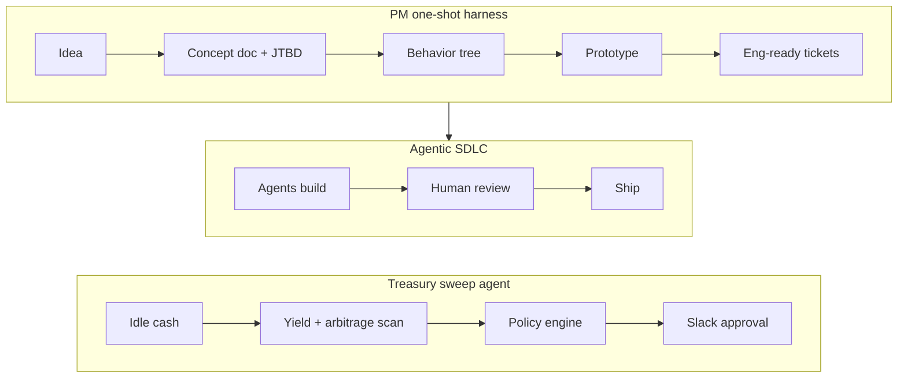

<h1 align="center">Hi 👋, I'm Mohsin</h1>
<h3 align="center">Product Manager (II) enabling Agentic Workflows 🤖 | Payments & Stablecoins</h3>

**Agentic Workflows · AI · Payments, Stablecoins & Core Infrastructure at [Fasset](https://fasset.com)**

Payments PM by day, agent builder always: I ship cross-border money products and the AI workflows behind them.

  
  

### AI harnesses & agents

- **[PM one-shot harness](https://github.com/Mosin112/pm-harness):** Claude skills that take an idea to a concept doc, behavior tree, clickable prototype and engineering-ready tickets in one pass. [Live demo](https://mosin112.github.io/pm-harness/).
- **Agentic SDLC:** helped define how product work feeds our engineering harness, with behavior trees and small outcome-based tickets that agents can build from.
- **Treasury sweep agent** *(publishing soon)*: finds idle cash across bank, exchange and wallet accounts and proposes yield and arbitrage moves. A policy engine enforces limits and people approve in Slack.

I also build agent skills, always-on and multi-agent systems, voice and browser agents, and MCP apps. I work prototype-first, keep context in Git, and keep a human in the loop for anything that moves money.

### Payments & stablecoins

- **$15M+ a month** in cross-border payouts across USD → PKR, BDT and NGN corridors
- **6 → 3 weeks** partner go-live, from one shared integration layer for **4 payment and banking partners**
- **USD virtual IBANs** and **stablecoin settlement** for GCC → APAC corridors, with **$1B+** in projected annual volume
- **[Fasset Engine](https://docs.fasset.com):** B2B APIs and SDKs for embedding digital-asset services
- **Treasury liquidity dashboard and hedging workflow**, saving **15+ hours a month**

### Blockchain & DeFi

- **[Folks Finance](https://folks.finance):** lending and borrowing smart contracts on Algorand (PyTeal)
- **A51 Finance** (formerly Unipilot): owned the roadmap and scaled it to **$1.5M TVL**, with **8.5%** better execution efficiency
- **IEEE BCCA 2024:** published paper on digital assets and blockchain
- Open source: [voting dApp](https://github.com/Mosin112/Decentralized-Voting-Aapplication) · [zk identities](https://github.com/Mosin112/Self_Sovereign_zk_identities) · [origami-js-sdk](https://github.com/open-oracle-origami/origami-js-sdk)

### Side projects

- **[axe.](https://www.axepayments.co):** regulated crypto rails for Pakistan. One API for PKR on- and off-ramps and stablecoin transfers over RAAST and IBFT. In sandbox.
- **[Kapray](https://github.com/Mosin112/Kapray-app):** one feed for Pakistani women's fashion brands (Expo, React Native, Supabase)
- **[HabitFlow](https://github.com/Mosin112/habitflow):** Android habit tracker (Kotlin, Jetpack Compose)

### Tools

  
  <a href="https://openai.com" title="OpenAI"><picture><source media="(prefers-color-scheme: dark)" srcset="https://cdn.jsdelivr.net/npm/@lobehub/icons-static-png@2.6.0/dark/openai.png" /></picture></a>
  
  
  
  
  
  
  
  
  
  
  
  
  
  
  
  
  
  
  
  
  
  
  
  
  

[LinkedIn](https://linkedin.com/in/mohsin-hafeez) · [mosin.hafeez112@gmail.com](mailto:mosin.hafeez112@gmail.com) · WAGMI
