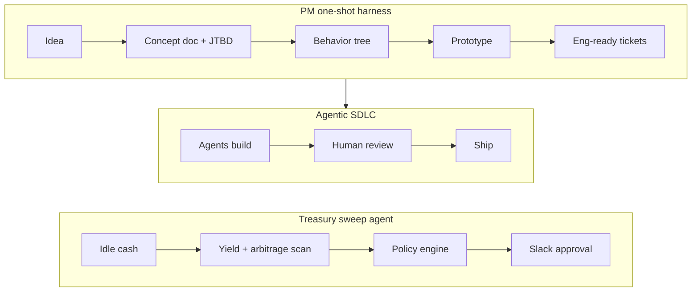

# Mohsin Hafeez

**AI-first Product Manager · Payments, Stablecoins & Core Infrastructure at [Fasset](https://fasset.com)**

I build products that move money, and the AI harnesses and agents that help teams build and run them.

---

### AI harnesses & agents

- **PM one-shot harness.** About 50 Claude skills that take an idea to a concept doc, a behavior tree, a clickable prototype and engineering-ready tickets in one pass. Open-sourcing it as `pm-harness` *(coming soon)*.
- **Agentic SDLC.** I helped define how product work feeds our engineering harness: concept docs, behavior trees and small outcome-based tickets that agents can build from, plus prototype-first handoffs.
- **Treasury sweep agent: `sweep-agent`** *(publishing soon)*. Finds idle cash across bank, exchange and wallet accounts and proposes ways to earn on it: stablecoin yield, tokenized treasuries, arbitrage. A policy engine enforces every limit, people approve in Slack, and every move is re-checked against fresh prices before it runs.

How I work with AI:

- **Prototype first.** I connect our Figma design system to Claude Code, so designers and engineers start from a working prototype instead of a blank page.
- **Context in Git.** Product docs live in version control, where they're versioned and agents can read them.
- **Human in the loop for money.** Agents do the work, and a person approves anything that moves funds.

### Payments & stablecoins

- **$15M+ a month** in cross-border payouts across USD → PKR, BDT and NGN corridors
- **6 → 3 weeks** partner go-live, after I designed one shared integration layer that every payment and banking partner plugs into
- **4 payment and banking partners** integrated end to end: REST APIs, webhooks, transaction status lifecycles and payment orchestration through omnibus wallets
- **USD virtual IBANs** shipped, connecting UAE banking rails and local payment methods with global banking partners
- **Stablecoin settlement** infrastructure for GCC → APAC remittance corridors, linking fiat and on-chain flows, with **$1B+** in projected annual volume
- **Fasset Engine**, our B2B product: APIs and SDKs that let wallets, exchanges and fintechs embed digital-asset services ([docs](https://docs.fasset.com))
- **Liquidity dashboard and hedging workflow** for Treasury and FinOps, saving **15+ hours a month** in reconciliation and reporting

### Blockchain & DeFi

- **[Folks Finance](https://folks.finance)**: contributed to the lending and borrowing smart contracts on Algorand, written in Python (PyTeal), at Blockchain Italia
- **A51 Finance** (formerly Unipilot): owned the product vision and roadmap for this automated liquidity protocol for concentrated-liquidity DEXs, scaling it to **$1.5M TVL**. Improved execution efficiency by **8.5%** using Python and Rust
- **DeFi research**: analysed arbitrage transactions on Uniswap v2 and v3 using Etherscan and EigenPhi
- **[Decentralized voting dApp](https://github.com/Mosin112/Decentralized-Voting-Aapplication)**: time-based on-chain voting, built in React and deployed on Ethereum
- **[Self-sovereign zk identities](https://github.com/Mosin112/Self_Sovereign_zk_identities)**: research on self-sovereign identity models using zero-knowledge proofs
- **[origami-js-sdk](https://github.com/open-oracle-origami/origami-js-sdk)**: open-source contributor
- **IEEE BCCA 2024**: published a paper on digital assets, cryptocurrencies and blockchain

### Side projects

- **[Kapray](https://github.com/Mosin112/Kapray-app)**: a mobile app that brings Pakistani women's fashion brands into one feed, with alerts for new drops and sales. Expo, React Native, Supabase, and its own [scraper](https://github.com/Mosin112/kapray-scraper).
- **[HabitFlow](https://github.com/Mosin112/habitflow)**: an Android habit tracker built with Kotlin, Jetpack Compose, Room and Hilt.

### Toolbox

- **AI:** `Claude Code` `MCP` `Agent skills` `Figma`
- **Payments:** `REST APIs & webhooks` `SWIFT/ACH` `Bank integrations` `Stablecoins`
- **Blockchain:** `Solidity` `PyTeal` `Ethereum` `Algorand` `Uniswap v2/v3`
- **Data:** `SQL` `Python` `Redshift` `Mixpanel` `Metabase`

---

[LinkedIn](https://linkedin.com/in/mohsin-hafeez) · [mosin.hafeez112@gmail.com](mailto:mosin.hafeez112@gmail.com) · WAGMI
